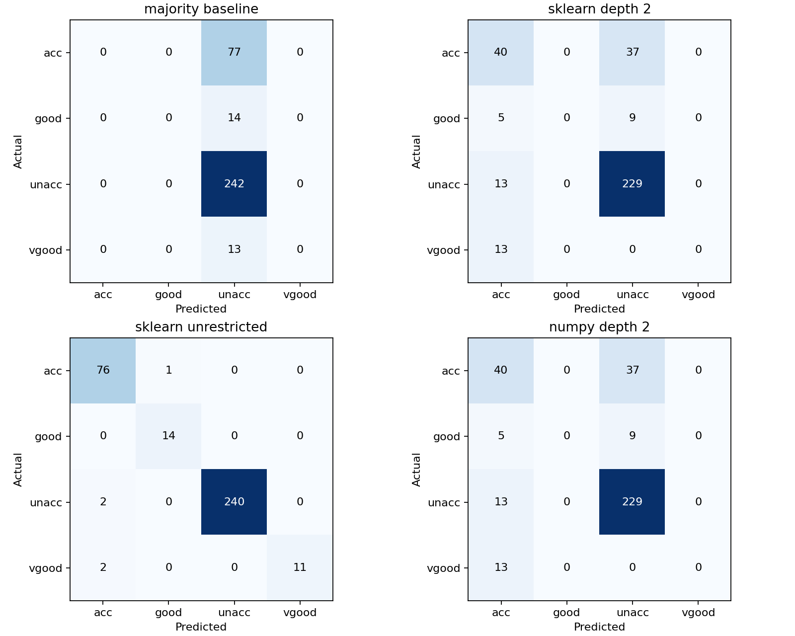
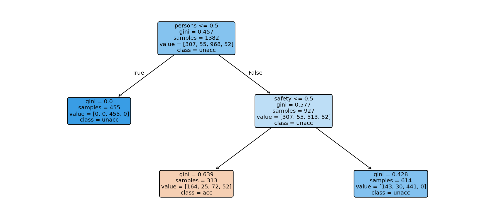

# How much tree is enough?

A Car Evaluation study comparing a small decision tree, an unrestricted tree and a classifier implemented with NumPy.

This began as my machine-learning coursework. The original code wasn't recovered, but my report was. This repository contains that report alongside a new, runnable reconstruction built with AI assistance. It explores the same question: what happens when a tree is too shallow to separate the classes?

## What the experiment found

One fixed, stratified 80/20 split: 1,382 training rows and 346 test rows, with random seed 42.

| Model | Training accuracy | Test accuracy | Test macro F1 |
| --- | ---: | ---: | ---: |
| Majority-class baseline | 70.04% | 69.94% | 0.2058 |
| Scikit-learn, depth 2 | 76.70% | 77.75% | 0.3566 |
| Scikit-learn, unrestricted | 100.00% | 98.55% | 0.9615 |
| NumPy implementation, depth 2 | 76.70% | 77.75% | 0.3566 |

These are measured results from this reconstruction, using the versions saved in `study/current-run/metrics.json`. The two scikit-learn test accuracies match the rounded values in my report. That agreement does not establish that the original source, split or setup has been recovered.

The report recorded 69.94% for its original scratch tree. The new NumPy tree reaches 77.75%. The old code is unavailable, so the cause of that difference is unknown. Interestingly, 69.94% is also the majority-class baseline on this split. An efficient library implementation alone is not an explanation for a different result: split candidates, tie handling and depth conventions can also differ.



Accuracy alone hides an important weakness: both depth-2 trees fail to predict the `good` and `vgood` classes here. Macro F1 and per-class recall make that visible. The unrestricted tree performs well on this split, but one test split does not establish robustness or suitability for real vehicle recommendations.

## Run it

Tested with Python 3.12.14. Use Python 3.12 with the pinned dependencies for the closest match to the included run. From this repository folder:

```sh
python -m pip install -r requirements.txt
python checks.py
python experiment.py
```

On Windows, `py -3.12` can replace `python` if several Python versions are installed. The dataset is included, so the experiment needs no network access after dependency installation. Running it regenerates the outputs under `study/current-run`.

## Read the experiment

`experiment.py` loads and validates the dataset, creates the split, fits categorical encoders on training data only, then trains and evaluates the four models. It saves the split indices, data checksum, encoding maps, dependency versions, confusion matrices and per-class metrics. No model settings are selected using the test scores.

`scratch_tree.py` implements weighted Gini split scoring, exhaustive feature/value search, recursive node construction and majority-class leaves using NumPy. It uses `feature < threshold`, excludes empty partitions, resolves equal split scores by feature/value iteration order, and allows zero-improvement splits so interactions such as XOR can still be learned. Root depth is zero: `max_depth=2` permits two split levels. `min_size` stops splitting a node at or below the specified size; it is not a minimum leaf-size guarantee.

`checks.py` contains six tests covering impurity, separable data, constant features, stopping rules, XOR and invalid inputs.



The tree diagram uses integer category codes. Their meanings are recorded in the feature encodings inside `metrics.json`.

## A note on categorical features

Each feature is encoded separately with lexicographically ordered integer category codes to follow the reported approach. For example, an alphabetical order for safety is not the same as its semantic order. Threshold-based trees can be affected by such ordering because it changes which categories can be grouped by one split. This method is a deliberate experimental choice, not a claim that arbitrary integer encoding is harmless. One-hot encoding is an extension worth comparing with cross-validation confined to the training set.

## Dataset and original report

UCI Car Evaluation has 1,728 complete rows, six categorical features and four target classes: `unacc`, `acc`, `good`, `vgood` (unacceptable, acceptable, good, very good). It is derived from a decision model rather than a collection of measured vehicle outcomes.

The unedited recovered report is in `study/coursework-report.txt`. It is historical evidence and includes wording errors: its class list omits acceptable, and some of its explanations overstate what a train/test gap can establish. The interpretations in this README distinguish those claims from the measured reconstruction.

Dataset credit: Bohanec, M. (1988). *Car Evaluation*. UCI Machine Learning Repository. [DOI: 10.24432/C5JP48](https://doi.org/10.24432/C5JP48). The included `car.data` and `car.names` are unmodified files from UCI, distributed under [CC BY 4.0](https://creativecommons.org/licenses/by/4.0/). Dataset attribution and checksum are recorded in `dataset/PROVENANCE.md`. That dataset licence does not apply to the coursework report or project code.

References: [UCI dataset page](https://archive.ics.uci.edu/dataset/19/car+evaluation) and [scikit-learn decision-tree documentation](https://scikit-learn.org/stable/modules/tree.html).
